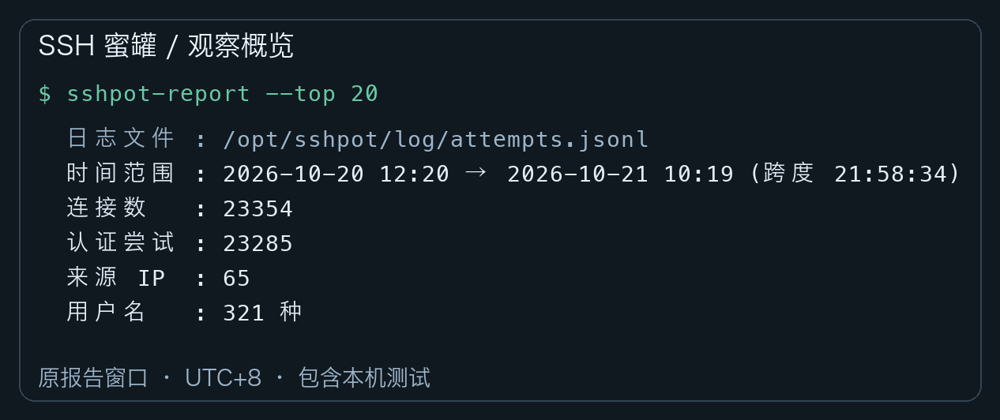
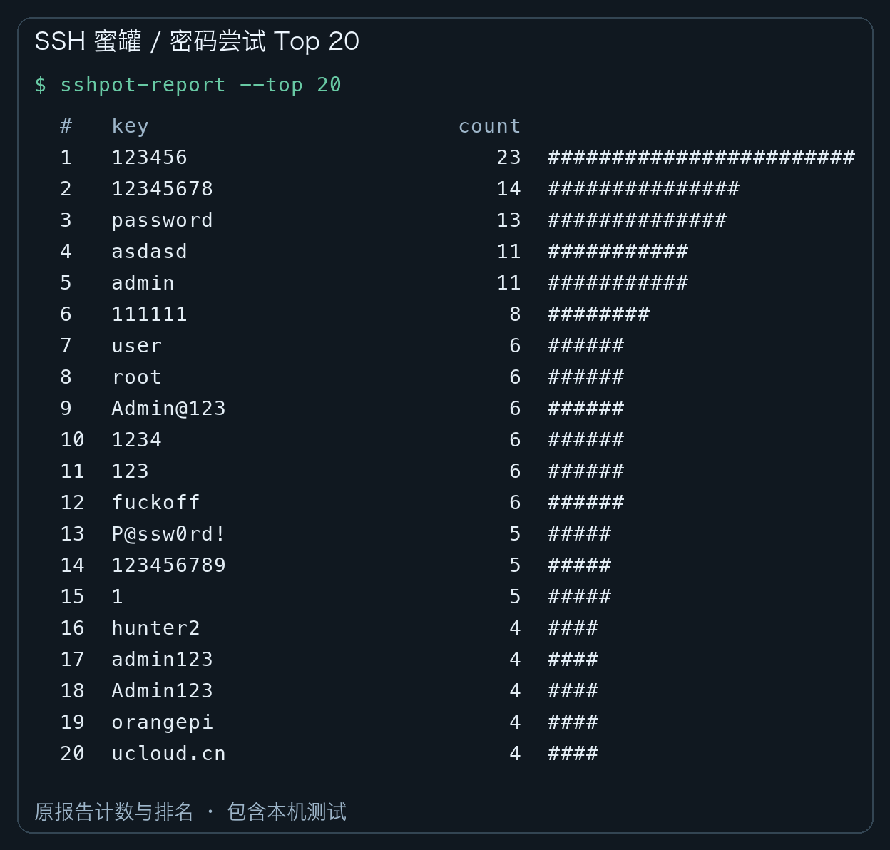
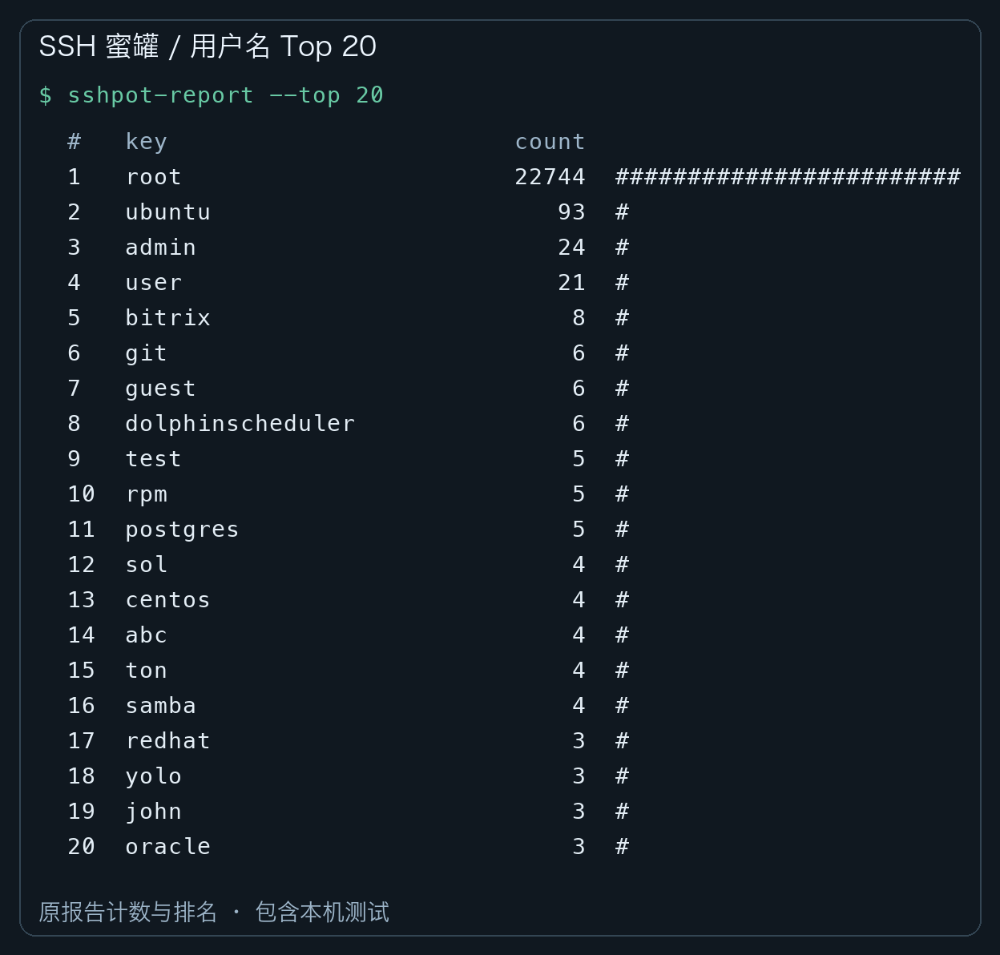
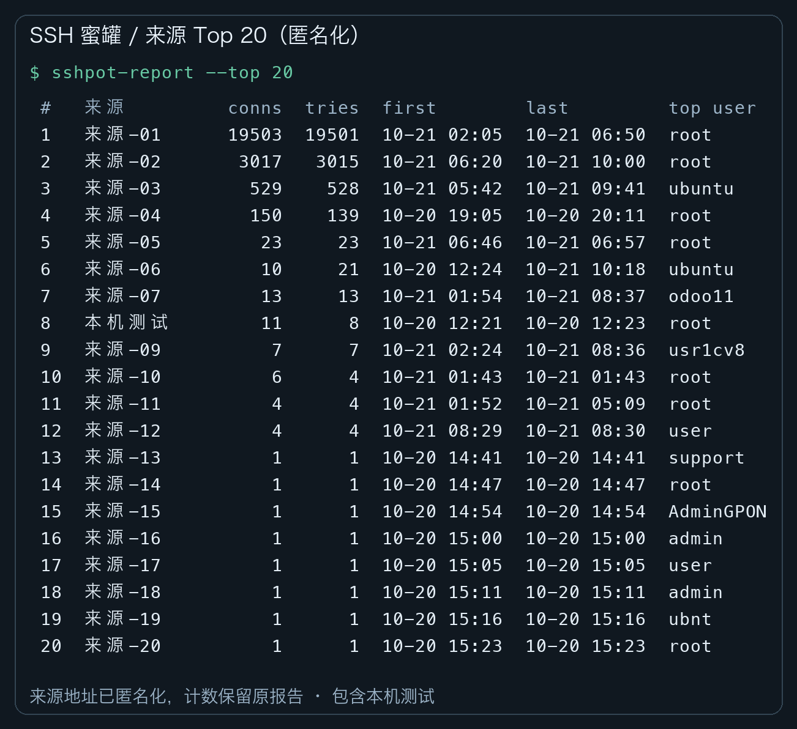
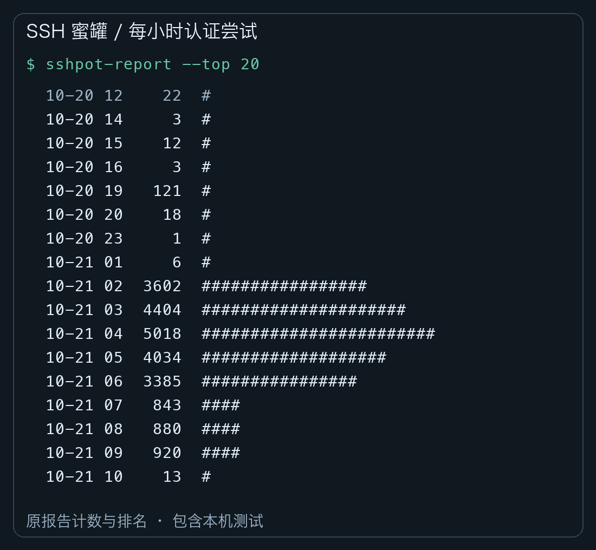

# 用 Python 写个 SSH 蜜罐，来一场密码字典的“草船借箭”
本来只是想验证一下知乎上看到的“草船借箭”，没想到不到 22 小时就记录了两万多次认证尝试。更有意思的是，密码榜前三还是那几个老朋友：123456、12345678 和 password。

## 起因：密码字典还能“草船借箭”？

前段时间在知乎看到一篇文章，里面提到一个挺有意思的说法：收集密码字典，最好的办法就是搭个蜜罐，让别人把字典送过来。

这不就是草船借箭嘛。

平常看服务器登录日志，看到一堆失败记录，多半只会觉得烦。但换个角度，这些请求里的用户名和密码，不也是一份现成的观察材料？

于是我用 Python 写了一个小小的 SSH 蜜罐，放在自己的 Ubuntu 机器上试了一下。功能很简单：**你来连接，我记录你尝试的认证信息，然后拒绝登录。**

先说明，本文只讨论自有或明确授权环境中的被动观察，不拿收集到的凭据去登录别人的机器。至于“最好的办法”，这是让我动手的起因，不是这次实验已经证明的结论。

## 先看结果：不到 22 小时，来了两万多次认证尝试

这次环境是 Python 3.12.3 + AsyncSSH 2.24.1。截取的报告从 2026 年 10 月 20 日 12:20 到次日 10:19，跨度 **21 小时 58 分 34 秒**，时间按服务器的 UTC+8 展示。

统计日志就不整段贴文本了，拆成几张图看起来更方便。图片可以点击查看原图。

[](./img/overview.webp)

不到一天，记录到 23,354 个连接、23,285 次认证尝试、65 个来源 IP，以及 321 种用户名。单看这个量，确实有一种“公网机器从来不缺访客”的感觉。

不过这几个数字不能混着用：

- 一个连接可以发生多次认证尝试，也可能还没认证就断开。
- 来源 IP 数不等于攻击者人数，更不等于组织数量。
- 认证尝试包含密码、公钥和键盘交互，不是每一条都有密码。

还有一个需要提前交代的地方：**报告包含我自己的本机测试。** 后面的图片保留原报告排名和计数，没有把它包装成一份完全排除测试数据的攻击报告。

## 老朋友还在：123456、12345678 和 password

我最想看的当然是密码榜。

[](./img/password-top20.webp)

第一名是 `123456`，23 次；第二名 `12345678`，14 次；第三名 `password`，13 次。

都这个时候了，这几个老朋友居然还稳稳坐在前排。看到结果的时候，我第一反应就是：**简单密码可能退出了你的日常习惯，但还没退出这些自动化尝试的字典。**

除了简单数字和英文单词，还有 `Admin@123`、`P@ssw0rd!` 这种“大写、小写、数字、特殊符号都齐了”的密码。所以密码复杂度要求，也不能只看字符种类；固定的常见模板，照样可以直接出现在字典里。

当然，这里说的“顶流”，只指**本次报告的尝试频次**。它不代表全网用户最常用的密码，也不能说明这些密码真的登进了什么服务器。蜜罐全都拒绝，根本没有成功率可算。

再看一个反差：两万多次认证尝试，怎么密码冠军才 23 次？

对同一观察窗口的原始 JSONL 做进一步统计后，带密码字段的事件有 **23,274 条**，不同的密码字符串有 **19,855 种**。也就是说，很多候选值只出现了一次或少数几次，头部几种密码并没有占据全部流量。

从“收集材料”的角度，确实借到了一批箭；但其中可能有测试值、随机字符串、工具生成的候选值，并不能把去重结果直接当成高质量密码字典。

## 不只是密码：root 和少数高频来源

### 用户名：先试 root 再说

[](./img/username-top20.webp)

`root` 被尝试了 22,744 次，约占全部认证尝试的 **97.7%**。第二名 `ubuntu` 才 93 次，这个差距相当直观。

后面还能看到 `postgres`、`git`、`oracle`、`dolphinscheduler` 等用户名。这些名字更像是在碰常见系统账户或服务账户，不过只凭名字，也不能断定对方用的是哪种工具。

### 来源：少数地址贡献了绝大部分尝试

为了不把文章写成 IP 点名册，下面把来源地址统一换成了匿名标签，本机回环来源标为“本机测试”。计数和时间都保留原报告。

[](./img/source-top20.webp)

前两个来源分别有 19,501 次和 3,015 次认证尝试，加起来 22,516 次，约占总数的 **96.7%**。

这意味着，虽然来源有几十个，但这次样本主要由少数高频来源决定。不能看到“65 个 IP”，就以为收集到了 65 份互相独立、同等分量的字典，更不能仅凭地址判断背后是谁。

### 时间：不是一直均匀地来

[](./img/hourly.webp)

原报告里，10 月 21 日凌晨 2 点之后，尝试量明显上去了，4 点这一小时最多，记录了 5,018 次。注意，这只是这段观察窗口的分布，不是什么“攻击者最爱凌晨四点”的规律。

客户端标识里大量出现 `SSH-2.0-Go`，也符合自动化客户端的观察线索。不过版本字符串可以自报，不能把它当作身份凭证。

原报告的客户端版本计数还高于连接数，这是因为统计脚本把认证开始、认证失败等带版本字段的事件都累加了，**不是按独立连接去重**。统计看着简单，口径一不留神就容易讲错。

## 实现其实很小：记录，然后拒绝

### SSH 交给库，自己处理认证回调

SSH 协议没有必要从头实现。我用的是 [AsyncSSH](https://asyncssh.readthedocs.io/)，基于 `asyncio`，可以直接实现 SSH 服务端的认证回调。

这里的“记录密码”也不是抓到了网络上的明文。SSH 传输仍然是加密的，只不过蜜罐本身就是接收认证请求的服务端，所以库会把密码交给认证回调。

核心流程就是：连接进来 → 开始认证 → 记录尝试 → 返回失败。

下面是实际代码中的关键方法，省略了其他认证方式和辅助代码；完整文件在后面的附件里。

```python
def begin_auth(self, username):
    """要求客户端进入认证流程，不能跳过认证。"""
    log("auth.start", src_ip=self.src_ip, username=username,
        client_version=self._cv())
    return True

def password_auth_supported(self):
    """向客户端声明支持密码认证。"""
    return True

def validate_password(self, username, password):
    """记录密码认证请求，始终拒绝登录。"""
    return self._reject(username=username, password=password, method="password")
```

这里 `begin_auth()` 的 `True` 不是“认证成功”，而是“需要认证”。如果返回 `False`，库可以直接放客户端通过，这个地方尤其不能写反。

### 统一记录失败，不提供真正的登录

```python
def _reject(self, **kw):
    """记录失败事件，到达尝试上限后断开连接。"""
    self.tries += 1
    log("login.failed", src_ip=self.src_ip, src_port=self.src_port,
        client_version=self._cv(), **kw)
    if self.tries >= MAX_TRIES:
        try:
            self._conn.disconnect(asyncssh.DISC_TOO_MANY_AUTH_FAILURES)
        except Exception:
            pass
    return False
```

这个脚本每个连接最多记录 6 次认证回调尝试，然后请求断开连接。所有认证路径都返回失败，也没有实现 Shell、文件传输或转发入口。

换句话说，它只观察门口敲门的人，不请人进屋。我没有做“登录成功后模拟终端”这一层，功能少一点，边界也清楚一点。

### JSONL 用来统计，文本日志用来看

日志函数同时写两个文件：`attempts.jsonl` 给脚本处理，`attempts.log` 方便直接查看。JSONL 的核心写入是下面两行：

```python
rec = {"eventid": "cowrie." + event, "timestamp": now.isoformat(), **kw}
_jsonl.write(json.dumps(rec, ensure_ascii=False) + "\n")
```

`now` 使用 UTC 时间，统计展示时再转成服务器本地时间；用户名、来源、认证方式等信息放在 `kw` 里。`cowrie.*` 只是这个脚本使用的事件命名，**并不表示运行的是 Cowrie 蜜罐**。

除了 password，脚本也记录 keyboard-interactive 输入和 publickey 指纹。公钥认证不包含密码，本次窗口的认证方式分别是 23,266 次密码、8 次键盘交互、11 次公钥。这也解释了为什么“认证尝试数”和“带密码的事件数”不相等。

## 源码怎么用，以及几个不能省的提醒

完整源码放在开源博客的 [sshpot 专题目录](https://github.com/youerning/blog/tree/master/sshpot)，也可以单独看 [蜜罐程序](https://github.com/youerning/blog/blob/master/sshpot/honeypot.py)、[统计脚本](https://github.com/youerning/blog/blob/master/sshpot/report.py) 和 [使用说明](https://github.com/youerning/blog/blob/master/sshpot/USAGE.md)。需要下载的话，可以在文件页面选择下载原始文件，或者从仓库首页通过 `Code → Download ZIP` 下载整个仓库。

公开源码是本次实验脚本的脱敏中文注释版，保留认证和统计逻辑，不附原始凭据日志、主机私钥或服务器地址。

下载后进入仓库的 `sshpot` 目录，用 Python 3.12 创建环境：

```bash
python3.12 -m venv .venv
source .venv/bin/activate
pip install -r requirements.txt
SSHPOT_PORT=2222 python honeypot.py
```

程序默认监听 2222，不是 22。**原脚本绑定的是所有本机接口**，本地体验建议放在隔离环境中，并用防火墙限制访问，不要把“拿来试试”变成误开放公网服务。

另开终端，从自己的机器连接：

```bash
ssh -p 2222 -o PreferredAuthentications=password \
  -o PubkeyAuthentication=no demo@127.0.0.1
```

提示输入时用专门的虚构测试值，别输入自己平时的密码。被拒绝是正常结果，可以去看生成的日志。

统计用下面的命令，显式指定当前目录的日志路径：

```bash
python report.py --log ./log/attempts.jsonl --top 20
```

`--since 24h` 可以查看最近 24 小时；这里要加 `--log`，因为脚本默认路径沿用了服务器上的 `/opt/sshpot/log/attempts.jsonl`。

真要做公网实验，有几件事不能省：

- 蜜罐与真实管理 SSH 分开，先确认管理入口可用，不要直接覆盖正在使用的端口。
- 用独立低权限用户和隔离环境运行，不把“永远拒绝登录”当成软件永远没有漏洞的保证。
- 限制出站访问，控制内存、连接和磁盘使用，安排日志轮转；这个小脚本没有完整解决长期运行的资源问题。
- 日志含明文凭据，不上传原始日志；目录、文件权限和备份都要保护，主机私钥也不要打包分享。

我实际运行时用了独立用户，并通过 systemd 做资源限制和加固。不过本文不展开公网部署步骤，尤其不提供可能把自己锁在服务器外面的端口迁移命令。

## 总结：借到了箭，但它不是万能字典

这次最有意思的，不是写了多复杂的程序，而是自己看到了这些尝试长什么样。

`123456`、`12345678`、`password` 还在本次榜单前排；用户名几乎一边倒地集中在 `root`；少数来源贡献了绝大部分尝试。只看三张榜，和只看“两万多次”这个总数，得到的印象就很不一样。

至于知乎上说的草船借箭，我觉得作为一种低成本的观察办法，确实值得试试。但结果受机器位置、暴露端口、观察时长和少数高频来源影响，还混有自己的测试，不能指望搭一个蜜罐，就拿到一份代表整个互联网的密码字典。

借到箭是一回事，箭好不好用、是不是重复的，是另一回事。

回到自己的生产机器，还是用密钥认证、确认可登录后再禁用密码登录，并尽量收紧管理入口。蜜罐负责长见识，真正的服务器可不能拿来验证这些密码有没有用。
